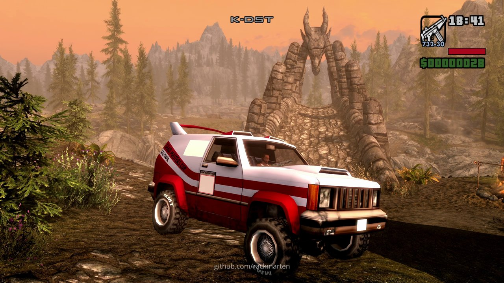
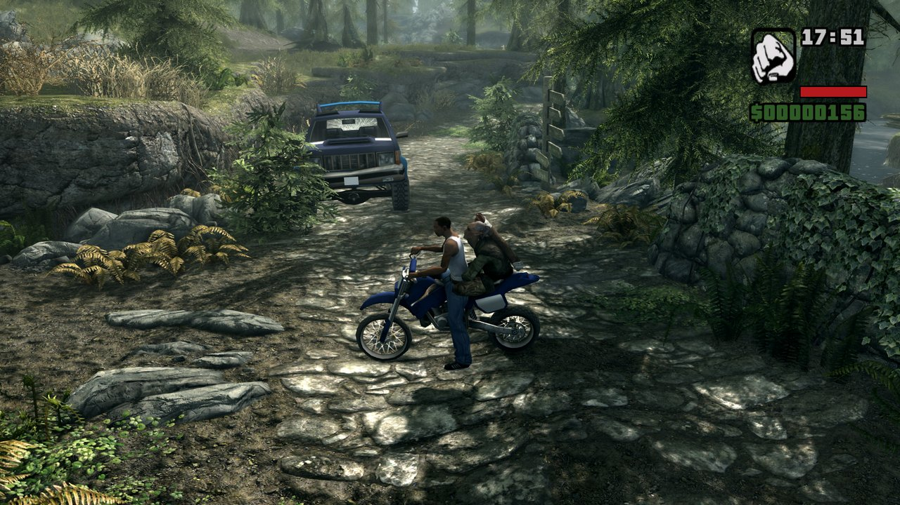
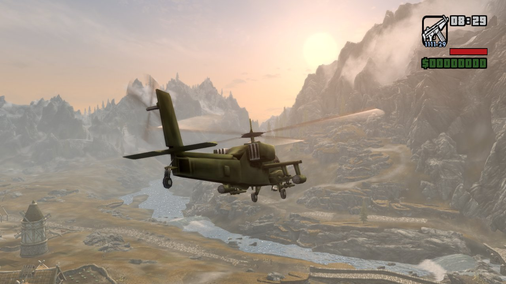
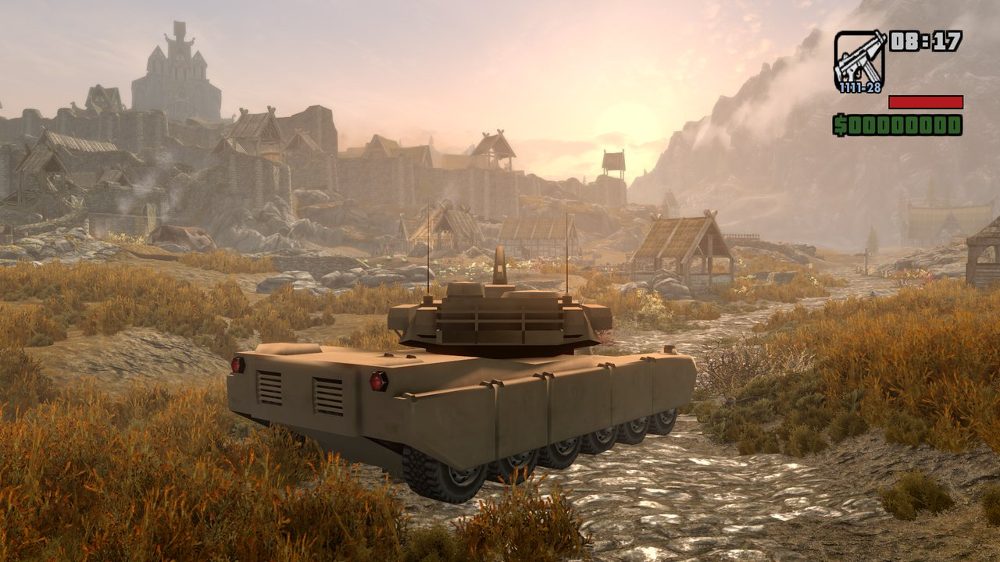
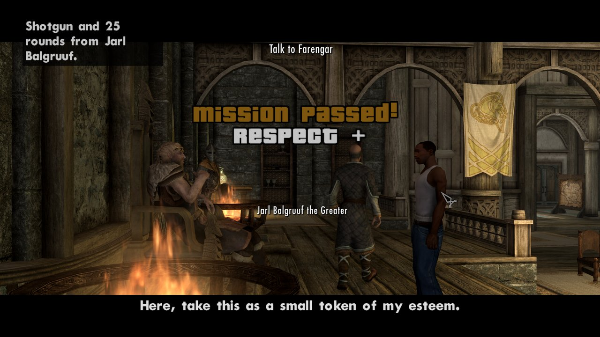

# AhShitRim

<p align="center">
  <b>Thane of Grove Street.</b> San Andreas in Skyrim.<br>
  <a href="https://github.com/rackmarten/AhShitRim/releases/latest"><b>Download</b></a> ·
  <a href="docs/INSTALL.md"><b>Install</b></a> ·
  <a href="#reporting-a-problem"><b>Report a bug</b></a>
</p>

<p align="center">
  <a href="https://www.youtube.com/watch?v=kBfgl2EbtLo"></a><br>
  <sub>▶ Watch the teaser on YouTube. The full montage comes later.</sub>
</p>

CJ from **Grand Theft Auto: San Andreas** plays through **Skyrim** (Special Edition 1.5.97 or Anniversary Edition). Both games run at once: Skyrim owns the world and draws everything, San Andreas runs hidden and simulates CJ, his cars, his guns and his cheat codes. Hijack a cart outside Helgen, do a drive-by on the Thalmor, and outrun Whiterun's guards with five stars on your head.

Version 0.1 takes you from the Helgen cart to the Greybeards. A sibling of [PerkeleRim](https://github.com/rackmarten/PerkeleRim) (My Summer Car in Skyrim), built the same way.

You need your own copies of both games: nothing from either is in this repository or its download.



<table>
  <tr>
    <td></td>
    <td></td>
  </tr>
  <tr>
    <td align="center"><sub>Faendal rides along on the Sanchez</sub></td>
    <td align="center"><sub>The Hunter over a river valley</sub></td>
  </tr>
  <tr>
    <td></td>
    <td></td>
  </tr>
  <tr>
    <td align="center"><sub>The Rhino below Whiterun</sub></td>
    <td align="center"><sub>Before the Storm, passed</sub></td>
  </tr>
</table>

## Download and install

Download `AhShitRim-0.1.0.zip` from [Releases](https://github.com/rackmarten/AhShitRim/releases/latest), extract it into a folder of its own and double-click `Start AhShitRim.bat`. [docs/INSTALL.md](docs/INSTALL.md) has every step, and the manual way. Each release is built by GitHub Actions, and its notes give the zip's SHA-256, its VirusTotal scan and how to verify GitHub's build attestation ([Check your download](docs/INSTALL.md#check-your-download)). You need:

- Windows 10/11 and a PC that can run both games at once (San Andreas is light)
- [The Elder Scrolls V: Skyrim Special Edition](https://store.steampowered.com/app/489830/), either Anniversary Edition (1.6.317 or later; the latest Steam version, 1.7.104, is the one tested most) or Special Edition 1.5.97, with the [SKSE64](https://skse.silverlock.org) build and the [Address Library for SKSE Plugins](https://www.nexusmods.com/skyrimspecialedition/mods/32444) file for that version. The same AhShitRim works on both
- [Grand Theft Auto: San Andreas](https://store.steampowered.com/app/12120/) (Steam), the classic game. AhShitRim runs on its 1.0 US exe only (one exe version means one set of memory addresses), and the launcher's setup gets you there. The Definitive Edition is a different engine and won't work.

The first time, the launcher's setup finds San Andreas, copies it so your original stays untouched, downloads the open-source downgrader and runs it on the copy, and adds an ASI loader, all in a few clicks. It installs AhShitRim's Skyrim part into Skyrim's `Data` folder for you (`Uninstall AhShitRim.bat` takes it out again), or you install it with Mod Organizer 2 or Vortex. After that, every launch checks both games, puts San Andreas's part in place, paints the radar's map from your own plugins, and starts both games.

## What you can do

Press **F10** in Skyrim and CJ takes over from the Dragonborn. Press it again to get Skyrim's own player back (for spells, lockpicking, menus and trading).

- **CJ on foot**, with San Andreas's movement, animations and camera, on Skyrim's own ground. He opens doors, pulls levers, searches chests, picks things up, talks to people and sits down with E, and stays the player through load doors, interiors, fast travel and scenes that take the player over.
- **Every land and air vehicle San Andreas has**: cars, bikes, bicycles, quads, monster trucks, the Rhino, helicopters, planes, the jetpack and the parachute, with San Andreas's own physics, radio, sounds and particles. Run people over, take your followers along, and watch Skyrim's bandits, wolves and giants wreck your car until it burns.
- **San Andreas's guns**, switched on the mouse wheel, hurting Skyrim's people and creatures: headshots count, damage scales with the target (the minigun is for dragons), the Dragonborn gets the kill and the bounty, and San Andreas's weapon skills grow. Rockets, grenades, Molotovs, tear gas, the flamethrower and satchel charges all work, and the heat seeker locks on to dragons.
- **Fist fights** with San Andreas's lock-on: CJ turns to his target, and a small triangle over their head goes from green to red with their health.
- **Ammu-Nation** at the blacksmiths of the hold capitals (Warmaiden's in Whiterun first), and guns as rewards from the main quest and a few bosses.
- **Looting without menus**: walk over a body, or press E on a chest, and its gold and quest items are yours.
- **Pickups** spinning around Skyrim: hearts, armour, parachutes, weapons and money, with a heart turning up when you're low.
- **Wanted stars** on top of Skyrim's bounty, endless reinforcements (with the hold's wolves from 3 stars), and **Busted** when a guard drags CJ out of a stopped car.
- **Wasted** when Skyrim's health runs out: CJ wakes at the hold's temple.
- **Quests as San Andreas missions**: mission titles, MISSION PASSED with its tune, odd jobs for the small quests, and the line the mod is named after in the Helgen cart.
- **CJ's own voice**: he answers in Skyrim's conversations (played like San Andreas cutscenes), comments on fights, loot and shopping, sings when he's bored, and shouts the Thu'um in his own words.
- **San Andreas's HUD** with its **radar**, fonts and text styles, its radio (plus Radio Sovngarde and our own Sweetroll FM), and **its cheat codes**, typed straight into Skyrim.

Skyrim's player stays the real player underneath, so quests, dialogue, bounties, kill credit and saves keep working. CJ's weapons, armour, skills, car and wanted level go in the SKSE co-save next to your Skyrim save. Load a save made while CJ had the player and he takes over again a couple of seconds after the loading screen, once the world is in.

## Keys

While CJ has the player (F10), the keys follow San Andreas's keyboard layout, modern by default. `KeyLayout=Classic` under `[Input]` in `Data/SKSE/Plugins/AhShitRim.ini` switches to San Andreas's own PC defaults (the keys in bold differ):

| Key (modern) | Key (classic) | On foot | In a vehicle |
|---|---|---|---|
| F10 | F10 | Hand the player back to Skyrim | Hand the player back to Skyrim (CJ comes out of the vehicle at the next handover) |
| F11 | F11 | Screenshot with the HUDs on it, to `Screenshots` next to `Start AhShitRim.bat` (also while Skyrim has the player) | Same |
| W / S | W / S | Walk forwards / back | Accelerate / brake, then reverse; both together a burnout (A / D turn the car on the spot) |
| Arrows up / down | Arrows up / down | Walk forwards / back | Lean a bike forward / back (stoppies, wheelies, clearing bumps); pitch an aircraft |
| A / D, arrows left / right | A / D, arrows left / right | Walk left / right | Steer |
| Mouse | Mouse | Look around | Look around |
| Left Shift | **Space** | Sprint (mash it for San Andreas's faster sprint) | |
| Space | **Left Shift or Right Ctrl** | Jump | |
| Space | **Space or Right Ctrl** | | Handbrake; in the Hydra or the Hunter, held, the heat-seeker lock-on (see the mouse buttons) |
| Left Ctrl | **C** | Crouch (Skyrim sneaks) | |
| Left Alt | Left Alt | Walk | |
| F or Enter | F or Enter | Get into the nearest vehicle | Get out |
| H or Caps Lock | Caps Lock or H | | Horn; with hydraulics (LOWRIDER), raise and lower the car; a police helicopter's searchlight |
| Q / E | Q / E | E: activate what the crosshair is on (or else what CJ faces), through Skyrim (open a door, pull a lever, pick up an item, talk, sit down); the help box top left says what ("E: Open Breezehome"). On a body or an unlocked chest it takes the gold and quest items, no menu; on a blacksmith with an Ammu-Nation it opens the shop; standing on a weapon pickup while CJ carries another gun of its kind, it swaps his for it | Look left / right (both together: look behind); an aircraft's rudder |
| Numpad 8 / 2 (or Page Up / Page Down), numpad 4 / 6 | Same | | San Andreas's turret keys: the Rhino's turret, the Hydra's nozzles between hovering and forward flight; with hydraulics (LOWRIDER), held with numpad 5, they bounce the car |
| Numpad 5, 2 or numpad + | Same | | San Andreas's sub-mission key: a plane's landing gear up and down, the crop duster's and Stuntplane's smoke, the hydraulics' jump with the numpad's arrows |
| Skyrim's Shout key (Z) | Skyrim's Shout key (Z) | Shout, as in Skyrim (hold for more words), from where CJ stands, where the camera looks; CJ shoves the air and shouts one of his own lines instead of the dragon words | Skyrim's shout and CJ's line, no gesture |
| ] | ] | Spawn a Sandking | |
| [ | [ | Spawn a ZR-350 | |
| `\` | `\` | Spawn a Sanchez dirt bike | |
| Mouse wheel | Mouse wheel | Next or previous weapon (San Andreas's slots) | Next or previous radio station (San Andreas's stations, Radio Sovngarde, Sweetroll FM, off) |
| Insert or 4 / Delete or R | Same | | Next / previous radio station |
| Right mouse button | Right mouse button | Aim: San Andreas's free aim; the sniper rifle, rocket launchers, M4 and camera go to their own first-person sights. With fists or a melee weapon, locks on to the nearest enemy in front and turns CJ to face them; with a gun, the enemy nearest the crosshair is marked (aim stays free) | The vehicle's second weapon: the Hunter's machine gun, the Hydra's missiles (heat-seeking once Space has held a dragon, mammoth, giant, centurion or rider in view until its marker turns red), the Rustler's and Seasparrow's guns; on a BMX or mountain bike the bunny hop (hold to crouch, let go to jump) |
| Left Ctrl or numpad 0 | Left Ctrl or numpad 0 | Left Ctrl: crouch (modern layout) | Same as the right mouse button |
| Left mouse button | Left mouse button | Fire (a melee weapon attacks, turning CJ to the nearest enemy in reach in front); with the parachute in the air, open it | The vehicle's weapon: the Hunter's rockets (heat-seeking once Space has locked on, as the Hydra's), the Hydra's flares, the Rhino's cannon (its turret follows the camera); a car's nitro |
| Left Alt or Right Ctrl | Left Alt or **Right Ctrl** | Left Alt: walk (classic: Right Ctrl also jumps) | Same as the left mouse button (in the classic layout Right Ctrl is the handbrake too, as San Andreas binds it) |
| X | X | Insult: CJ shouts one of his insults at whoever's about and gives the finger | Insult out of the window (no finger) |
| Middle mouse button | Middle mouse button | Swear: CJ swears to himself ("oh shit") | Look behind |
| V or Home | V or Home | Change the camera distance: San Andreas's three chase distances (San Andreas's camera key) | Change the camera distance; one step is the view from the front of the vehicle, with San Andreas's crosshair in the Hunter, Hydra, Seasparrow and Rustler |
| W / S, arrows up / down | W / S, arrows up / down | In Ammu-Nation: browse | |
| E, Left Shift | E, **Space** | In Ammu-Nation: choose a category, buy | |
| F or Enter | F or Enter | In Ammu-Nation: back, then leave | |

Escape, Tab and the console stay Skyrim's. M doesn't open Skyrim's map while CJ has the player (it's a letter of the cheat codes): the map is in Tab's menu, as San Andreas's is in its pause menu.

The build also has a few developer keys, off Skyrim's default binds: `;` picks a vehicle from a list (NRG-500, BMX, Quad, Monster, Rhino, Hunter, Hydra, Sparrow, Maverick, Dodo, Stuntplane, Vortex, the jetpack, the parachute) and `'` spawns it, `=` hands out San Andreas's weapon sets, and `/` shows each of San Andreas's text styles. `[Debug] VehicleKeys=0` and `WeaponKey=0` in `AhShitRim.ini` turn the first three off.

## Playing as CJ

**Vehicles.** A spawned vehicle is parked across CJ's path, on the first flat, clear spot in front of him. In a helicopter or a plane W and S are the throttle, A and D roll, the arrows pitch and Q and E the rudder, as in San Andreas. On the jetpack Shift goes up and Space down (Space and Shift in the classic layout), F takes it off standing still. Carrying the parachute, CJ skydives off anything high enough: W dives, S slows, A and D turn, the left mouse button opens the chute. Up to four vehicles exist at once; another one replaces the oldest one CJ isn't in. Followers within 30 m ride along when CJ gets in, and Skyrim's attacks hit the car instead of anyone in it (a bike shields half).

**The Hydra is experimental.** Skyrim streams its land fast enough for it, but only has collision for the ground about a second ahead at that speed, so flying low and fast you can fly through hills. Out over the Sea of Ghosts Skyrim drops to a few frames a second. Fly high, or slow down to land.

**Ammu-Nation** is under the counter at the blacksmiths: Adrianne Avenicci and Ulfberth War-Bear at Warmaiden's in Whiterun, Beirand in Solitude, Oengul War-Anvil in Windhelm, Balimund in Riften, Ghorza gra-Bagol in Markarth, Rustleif in Dawnstar and Lod in Falkreath. E on one opens San Andreas's shop menu (F10 to talk to them as Skyrim's player). Everything is for sale from the start, paid in gold: pistols from 150, shotguns, sub-machine guns, assault rifles, rifles, heavy weapons (a rocket launcher is 6,000, the minigun 15,000), thrown weapons and body armour (200). A gun CJ has sells its ammo instead. The main quest gives guns too, up to the Greybeards (a rocket launcher), and so do the bosses of Embershard Mine, Bleak Falls Barrow, Halted Stream Camp and Silent Moons Camp.

**Looting.** Walking over a dead body takes its gold and quest items, as does E on a body or an unlocked chest; the gold counts up in the money display with San Andreas's money sound, and quest items show in the help box. Everything else stays where it is: Skyrim's inventory, barter and container menus don't open while CJ has the player, so press F10 for them.

**Pickups.** Hearts, body armour, parachutes, weapons and wads of gold float and spin at spots across Skyrim. Walk into one to take it; a weapon pickup of a kind CJ already carries swaps his gun only when you press E, as in San Andreas. When CJ is down to a quarter of his health a heart turns up in front of him.

**Nobody important stays dead.** Every named NPC CJ kills (the blacksmiths, the Jarl, Farengar, Delphine, the Greybeards, anyone unique) gets up again an in-game hour later, back where they belong, once their body and their spot are out of CJ's sight. Only CJ's kills: what Skyrim's own player or a dragon kills stays dead.

**Quests** start and end like San Andreas missions: a quest's name comes up as a mission title, finishing one is MISSION PASSED with San Andreas's tune, and a small quest done (a favour, a delivery) is an odd job, MISSION PASSED without the title. A new game opens with the line AhShitRim is named after: right after Ralof wakes you in the Helgen cart, CJ says "Ah shit, here we go again."

**Conversations** play like San Andreas cutscenes (nobody starts one with CJ while he's in a vehicle or moving faster than a walk): letterbox bars, a two-shot of CJ and the speaker, Skyrim's subtitles in San Andreas's style. CJ greets people, answers each topic you pick in his own voice (agreeing, refusing, asking, threatening, joking) and says goodbye. E or the left mouse button skips the speaker's line.

**Shouts.** Shouting works as in Skyrim (learn the words, hold the Shout key for more of them, wait out the cooldown), and the effect is Skyrim's, but instead of the dragon words CJ yells one of his San Andreas lines, picked for the shout and how many words you charged. Whirlwind Sprint carries CJ along with the dash, and WANRLTW (infinite ammo) also means infinite shouting. Dragons, draugr and the Greybeards still shout in their own voices. Which lines go with which shout (and with each situation below) can be picked by ear in the voice picker ([`scripts/voice-picker`](scripts/voice-picker/README.md)), which builds a local page from your own San Andreas install.

**CJ talks on his own** now and then: when a punch lands, a burst of gunfire hits, he aims a gun on foot, after a sneak kill, when he loots gold, buys at Ammu-Nation and leaves, sprints away from a fight, or crashes hard. Left idle for a minute and a half, he sings.

**Sound.** San Andreas plays CJ's, his vehicles' and his speech's sounds itself, at Skyrim's volume sliders. In a vehicle the radio plays San Andreas's stations, then **Radio Sovngarde**: Skyrim's own music (the main theme, combat and exploration tracks, the bards' instrumentals). After it comes **Sweetroll FM**, AhShitRim's own station: about half an hour of public domain (CC0) bard, tavern and folk music, shuffled so every track plays once before any repeats. Skyrim's own music stops while either station plays.

## The radar

While CJ has the player, San Andreas's radar stands in for Skyrim's compass, bottom left as in San Andreas. It turns with the camera and zooms out when CJ drives fast. On it: the marker you put on Skyrim's map (San Andreas's red waypoint), your quest targets (as San Andreas's yellow squares, a triangle up or down when the target is above or below CJ), Ammu-Nation's gun icon near the blacksmiths who keep one, and red dots for whoever is fighting you. Far targets sit on the rim. Indoors it goes dark with only the markers on it.

The map is a San Andreas-style map of Skyrim the launcher paints from your own plugins when it starts (`radar-map.png` and `radar-map.json` in `Documents\My Games\AhShitRim`); without it the radar shows plain grey ground.

## Wanted level and Busted

Skyrim's crime system stays: the bounty is Skyrim's, kept per hold, and its guards still arrest, fine and fight the player. On top of it San Andreas's wanted stars show while CJ has the player:

- Each crime heats things up, as in San Andreas: shooting a guard is one star, killing two is two stars, four is three, and six stars take a real rampage. Petty crimes (trespassing, theft) are a star at most.
- Out of the guards' sight for a few seconds the stars flash, then go one at a time. Killing the witnesses wipes Skyrim's bounty but not the stars.
- Reinforcements keep coming while CJ is wanted, never where he's looking. From 3 stars the hold sets its tamed wolves on CJ, fast enough to catch him sprinting and even a car for a while. From 4 a captain and a guard wizard join, from 5 the hold's soldiers and a dragon, and at 6 two giants and a mammoth (out in the open world only). At most 12 at once.
- As in San Andreas, no saving while wanted: F5 and F9 do nothing ("Lose the heat first") while stars show or reinforcements are still about.
- Skyrim's guards go easy on CJ at first: 0.4 of their damage at 1 star, rising to all of it from 5, times `DamageTaken` (see [Combat balance](#combat-balance)). Bandits, wolves and everyone else hit as usual, never by the stars.
- In a car, stop for a second or two and the nearest guard runs round to the driver's door and drags CJ out: Busted. On a bike he knocks CJ off. Keep moving and they can't, and nobody busts CJ while he's getting in or out.
- Busted takes the bounty out of CJ's gold (all of it if that's short), clears it, and CJ comes to outside the hold's barracks with all his weapons. No jail. Paying the fine to a guard ends the stars too.

## Cheat codes

Type San Andreas's PC cheat codes while CJ has the player, as in San Andreas: no console, just the letters, and the help box says "Cheat activated" (or "Cheat deactivated" for a toggle) with San Andreas's beep. San Andreas's alternative spellings work too (ROCKETMAN, FULLCLIP...). Some favourites:

| Code | What |
|---|---|
| HESOYAM | Health and armour full, 250,000 gold, the car mended |
| BAGUVIX | Toggle: the player can't be hurt |
| LXGIWYL, KJKSZPJ, UZUMYMW | Weapon sets 1, 2 and 3 |
| WANRLTW | Toggle: infinite ammo (and no shout cooldown) |
| AEZAKMI | Toggle: never wanted |
| OSRBLHH / LJSPQK / ASNAEB | Two more wanted stars / six stars / no stars |
| IAVENJQ | Toggle: mega punch |
| YECGAA / AIYPWZQP | The jetpack / a parachute |
| JUMPJET, OHDUDE, AIWPRTON | A Hydra, a Hunter, a Rhino |
| RIPAZHA | Toggle: flying cars |
| BSXSGGC | Toggle: cars CJ hits float away |
| MINIGUN | A minigun with 500 rounds (ours) |
| PAINT | New colours for CJ's car, mended (ours) |
| LOWRIDER | Hydraulics on CJ's car (ours) |
| NOMERCY | Toggle: nobody is essential any more (ours, read the warning below) |

Every vehicle also comes by its San Andreas name (SANCHEZ, HYDRA, MAVERICK), and a plane comes already flying with AIR before its name (AIRAT400). Every code, with its aliases: [docs/CHEATS.md](docs/CHEATS.md).

> **NOMERCY can break quests.** It takes the essential flag off every person and creature but the player, so quest givers, followers and anyone a quest still needs can die. The named ones come back an hour later like anyone named, but a quest that failed when they died stays failed, and Skyrim's own quests weren't written for that. Typing NOMERCY again gives exactly those flags back. It stays on in your saves until you type it again, so **save before you try it**.

## Settings

`Data/SKSE/Plugins/AhShitRim.ini` (the launcher writes it and keeps these):

| Section | Key | What |
|---|---|---|
| `[Input]` | `KeyLayout` | `Modern` (default) or `Classic`, the keys above |
| `[Missions]` | `MiscPassed` | `1` (default): a small quest done (a favour, a delivery) shows MISSION PASSED! with San Andreas's jingle, as its odd jobs do. `0`: Skyrim's own notifications for those |
| `[Hud]` | `Compass` | `1` keeps Skyrim's compass up beside the radar; `0` (default) hides it |

## Combat balance

How hard CJ hits and how hard he's hit, under `[Balance]` in `Data/SKSE/Plugins/AhShitRim.ini` (read when the game starts):

```ini
[Balance]
CJDamage=1.0         ; CJ's guns and explosives, times this (melee isn't touched)
DamageTaken=1.0      ; what Skyrim's people and creatures do to CJ, times this
FollowDifficulty=1   ; 1: Skyrim's difficulty scales CJ's guns too, 0: it doesn't
```

- With `FollowDifficulty=1` CJ's guns and explosives deal what Skyrim's player would at the next harder difficulty (Skyrim's own `fDiffMultHPByPC*` a step down): 1.5 at Novice, 1 at Apprentice, 0.75 at Adept, 0.5 at Expert, 0.25 at Master and at Legendary. Fists and melee weapons stay as they are. Skyrim already puts its difficulty on what its people do to the player, CJ included.
- So a level 6 bandit takes 6 Colt 45 body shots at Adept and 18 at Master (5 at Master before). `CJDamage=0.25` with `FollowDifficulty=0` gives Master's at any difficulty.
- CJ's body armour (the blue bar) takes the damage first, as San Andreas's does: weapons, arrows, creatures' bites, claws and clubs, traps (blades, spikes, rocks), blasts, and fire, frost and shock from spells, enchantments, traps and burning oil. A hit's share of his health bar comes off the armour point for point, and only what's left over comes off his health. Poison, disease, drowning and falls go straight to his health.
- Skyrim's fire (a fire spell, a fire trap, burning oil, a dragon's breath) sets CJ alight in San Andreas, with his scream and the burn, as San Andreas's own fire does.
- `DamageTaken` multiplies every hit Skyrim's people and creatures land on CJ. Guards (and the reinforcements) also hit by the stars, on top of it (see below); nobody else does.
- BAGUVIX still blocks everything.

## Known issues

- **The main quest** beyond Helgen isn't fully played through as CJ yet. If something blocks the way (a scene, a door, a menu), F10 hands the player back to Skyrim.
- **Helgen**: the intro (the cart and the execution) isn't supported as CJ: play it as Skyrim's own player and press F10 afterwards. CJ's "Ah shit, here we go again." still plays in the cart.
- **Camera**: no first person on foot (San Andreas has none either). A vehicle's first-person view sits just in front of it, so driving into a wall puts the camera in the wall.
- **CJ and the vehicles** cast no shadow, and CJ always wears his starting clothes.
- **Vehicle looks**: damage isn't shown (dents, broken windows and lost doors), and lights aren't drawn. The Hydra's flares are invisible (they still work), and its jet exhaust, missile trails, heat haze, a submerged exhaust's bubbles and the rotor dust's sand and water versions aren't drawn. Muzzle flashes are round where San Andreas stretches them along the barrel.
- **Vehicles are temporary**: they live only while CJ has the player. They're hidden when Skyrim takes it back, and the next F10, load door or fast travel removes them. Fast travelling in a vehicle leaves it behind.
- **Driving**: every surface grips like tarmac, and a low sports car like the ZR-350 scrapes on Skyrim's rocks (its ground clearance, not a collision bug).
- **In a closed car** CJ is safe from everything Skyrim does to the player, a trap's or poison's damage too, not only the hits the car takes.
- **Passengers** don't use the doors: they take their seat and stand up beside it. A bike passenger sits upright. If one sits at the wrong height, try another `SeatDrop` under `[Passengers]` in `AhShitRim.ini`. No drive-bys.
- **Shops and menus**: Skyrim's barter (Belethor's shop and every other merchant), inventory and container menus close as they open while CJ has the player. Press F10 to trade, take anything but gold and quest items, or talk to a blacksmith who has an Ammu-Nation.
- **Wanted level**: the balance of the star tiers (how many come, how fast, how hard they hit) is a first go, and feedback is welcome. The police scanner stays off, a car CJ was busted out of is left behind, and reinforcements only come outdoors.
- **Sitting**: CJ sits on anything Skyrim's player uses as furniture, in the same chair pose (a forge, a bed, a horse). A scene that leaves the player standing or kneeling shows CJ standing. In a carriage CJ sits on the ground beside it (the ride itself works).
- **Conversations**: CJ's answers are his calm lines nearest each kind of topic, so some fit oddly. The cutscene camera ignores whatever stands between it and the two of them except walls.
- **Radio Sovngarde** plays the bards' instrumentals, not their sung songs.
- **Guns**: bullet holes leave no decal. A boss's gun reward comes again if you load a save from before it and kill the boss again.
- **Explosives**: with four or five Molotovs burning at once the later ones' outer flames are silent and don't set CJ alight (Skyrim's flames and damage still work). The spray can and extinguisher do nothing. Rockets leave no smoke trail, and the heat seeker's homing is our own. Satchels are dropped at a load door or F10. Locks only a key opens stay locked.
- **Memory**: Skyrim keeps every vehicle model it was sent until it quits (a few MB each), so spawning dozens of vehicles in one session uses up memory.
- **Saving while wanted**: as in San Andreas, F5 and F9 do nothing ("Lose the heat first") while stars show or reinforcements are still about. Lose the stars, or ASNAEB, then save.

## Reporting a problem

Found something else? Open an [issue](https://github.com/rackmarten/AhShitRim/issues) with what you did, what you expected, and both logs: `Documents\My Games\Skyrim Special Edition\SKSE\AhShitRim.log` (the last two runs' beside it as `AhShitRim.1.log` and `AhShitRim.2.log`) and `scripts\AhShitRim.log` in your San Andreas folder.

## Game assets

This repository and its releases contain **no assets from San Andreas or Skyrim**, and contributions must not add any. You need your own copies of both games. Models, sounds and textures are read from your installs at play time, never converted or redistributed.

The one exception is our own music: Sweetroll FM's 11 tracks, CC0 (public domain) music by other artists, listed with their sources in [`music/CREDITS.md`](music/CREDITS.md). Still nothing from either game.

## How it works

- An **SKSE plugin** (C++) samples Skyrim's collision around the player and draws CJ, his vehicles and weapons inside Skyrim from San Andreas's own models, read from your install at play time.
- An **ASI plugin** (C++, [plugin-sdk](https://github.com/DK22Pac/plugin-sdk)) empties San Andreas's map, builds Skyrim's collision there around a floating origin, runs CJ, vehicle and weapon physics on it, and streams poses and events back.
- The two talk over versioned shared memory.

Building it yourself: [docs/DEV_SETUP.md](docs/DEV_SETUP.md). Design: [docs/DESIGN.md](docs/DESIGN.md). The link between the games: [docs/PROTOCOL.md](docs/PROTOCOL.md). What changed: [CHANGELOG.md](CHANGELOG.md).

## Credits

- [CommonLibSSE-NG](https://github.com/alandtse/CommonLibSSE-NG) for the SKSE plugin, and [plugin-sdk](https://github.com/DK22Pac/plugin-sdk) for the San Andreas one.
- [gta-reversed](https://github.com/gta-reversed/gta-reversed), whose reading of San Andreas's code this mod leans on everywhere.
- [DirectXTK](https://github.com/microsoft/DirectXTK) for the overlay, [doctest](https://github.com/doctest/doctest) for the tests.
- Sweetroll FM's music: RandomMind, DST, Spring Spring, Yoiyami, David-Sky Marchant and Stephen Warde Anderson, who dedicated it to the public domain ([`music/CREDITS.md`](music/CREDITS.md)).
- [PerkeleRim](https://github.com/rackmarten/PerkeleRim), the My Summer Car mod whose two-games-at-once design this one follows.

## License

[MIT](LICENSE) © Marek Uncik ([rackmarten](https://github.com/rackmarten)). The license covers AhShitRim's own code and docs only: no Rockstar or Bethesda assets are included, and the plugins read what they need from your own installs at play time.

Not affiliated with or endorsed by Rockstar Games, Take-Two Interactive or Bethesda Softworks. Grand Theft Auto, San Andreas and Skyrim are trademarks of their respective owners.
